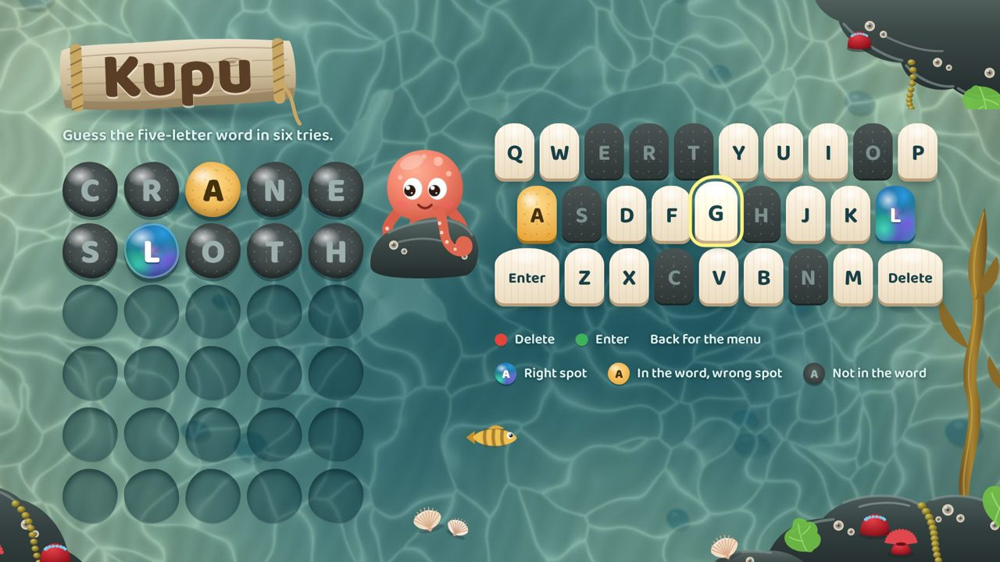
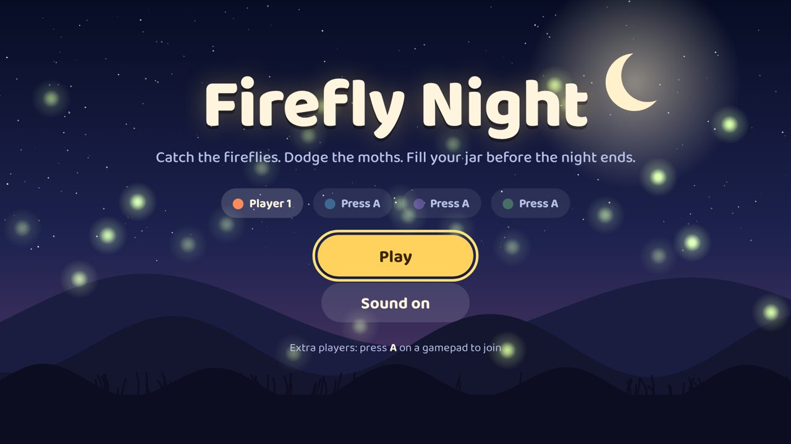

# LG TV Game Skill

A Claude skill that takes someone from a game idea to a playable game on their LG smart TV. It builds the game, packages it for the TV, publishes a preview you can try on a phone, and writes plain-English setup instructions, applying design guidance for games played from the couch.



## What it does

LG TVs run webOS, whose apps are web pages packaged as `.ipk` files. Ask Claude something like "make a game the kids can play on our LG TV" and the skill will:

1. Agree the idea in one short exchange and write a design brief: core loop, controls, how players join, art direction, and one idea that pushes the format.
2. Scaffold the game from a template and build it.
3. Check it for common TV and store-review problems, screenshot it and review its own work.
4. Package an `.ipk`, publish a playable preview, and hand over `SETUP.md` and `PUBLISHING.md`.

The template includes `kit.js`, a small dependency-free runtime for TV games. It handles the remote (including the Back and colour buttons), the Magic Remote pointer, up to four Bluetooth gamepads, keyboard and touch. It also provides focus navigation for menus, a fixed-step game loop, synthesised sound, saving and quitting. The sample game, Firefly Night, is couch co-op for up to four players.



The `references/` folder holds the guidance Claude follows: look and feel for the ten-foot screen, gameplay for mixed-age families, input, performance on TV hardware, and publishing to the LG Content Store.

## Install the skill

Download `lg-tv-game.skill` from the [latest release](../../releases/latest), or build it yourself with `bash build.sh`, then upload it to Claude as a custom skill from Settings. Claude's help centre has the current steps.

## Use the tools without Claude

The scripts work on their own with Python 3, Pillow and Node.js.

```bash
python lg-tv-game/scripts/new_game.py --title "My Game" --out my-game --id com.yourname.mygame
python lg-tv-game/scripts/check_game.py my-game
python lg-tv-game/scripts/inline.py my-game my-game-preview.html
bash lg-tv-game/scripts/package.sh my-game dist
```

Then follow `my-game/SETUP.md` to put the TV in Developer Mode and install it. Open `my-game/index.html` in a desktop browser to play without a TV: arrow keys, Enter and Esc stand in for the remote.

## Layout

```
lg-tv-game/                 the skill
  SKILL.md                  workflow Claude follows
  assets/template/          starter game: kit.js, game.js, style.css, font
  assets/examples/kupu.html finished word game, a reference for art direction
  assets/SETUP.template.md  player-facing install guide
  assets/PUBLISHING.md      getting a game out of Developer Mode
  references/               design, gameplay, input, performance, publishing
  scripts/                  scaffold, check, inline, screenshot, package
build.sh                    builds lg-tv-game.skill
```

## Credits and licences

Code and documentation are released under the MIT licence; see `LICENSE`. The bundled Baloo 2 font is under the SIL Open Font License (`lg-tv-game/assets/template/fonts/OFL.txt`). Kupu's accepted-guess list comes from [dwyl/english-words](https://github.com/dwyl/english-words), which is in the public domain. Kupu's answer list is a hand-filtered selection of common words.

LG, webOS and Magic Remote are trademarks of LG Electronics. This project is not affiliated with or endorsed by LG.
